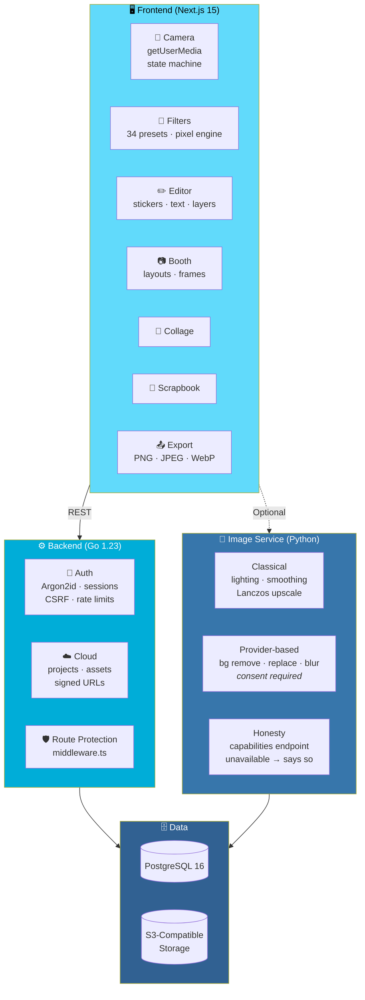

# 🌸 BlushCam — your camera, your aesthetic

<div align="center">


**A private, in-browser photo studio.**

*Live camera · 34 filters · Korean four-cut booth · Stickers · Collage · Scrapbook · Honest AI tools*

[🚀 Quick Start](#-quick-start) • [✨ Implemented](#-implemented) • [🏗️ Architecture](#️-architecture) • [⚠️ Not Implemented](#-not-implemented--needs-credentials) • [✅ Verification](#-verification-status-what-was-actually-run-when-this-repo-was-generated)

</div>

---

## 📖 Overview

**BlushCam** is a **private, in-browser photo studio**.

### What It Does

- 📸 **Live camera** with device selection and timer
- 🎨 **34 filters** in 7 categories
- 📷 **Korean four-cut booth** with auto-capture
- 🧩 **Stickers and text** on a full canvas editor
- 🖼️ **Collage maker** with 10 layouts
- 📖 **Multi-page scrapbook**
- 🤖 **Honest AI tools** — labelled as classical or generative
- ☁️ **Optional cloud** via Go + PostgreSQL

### 🛠️ Tech Stack

<div align="center">

| Part | Technology |
|------|-----------|
| **`frontend/`** | Next.js 15 *(App Router)* · React 19 · strict TypeScript · Tailwind · Canvas API |
| **`backend/`** | Go 1.23 · chi · pgx · **Argon2id** · S3-compatible storage |
| **`image-service/`** | Python 3.12 · FastAPI · Pillow · NumPy · OpenCV *(optional)* |
| **Infra** | PostgreSQL 16 · Docker Compose · GitHub Actions CI |

</div>

### 📚 Documentation

- **[Architecture](docs/architecture.md)**
- **[API](docs/api.md)**
- **[Database](docs/database.md)**
- **[Privacy](docs/privacy.md)**
- **[Deployment](docs/deployment.md)**

---

## 🚀 Quick Start

### 🐳 Everything with Docker

```bash
cp .env.example .env            # set POSTGRES_PASSWORD and STORAGE_SIGNING_SECRET=$(openssl rand -hex 32)
docker compose up --build       # http://localhost:3000
./scripts/seed-templates.sh     # optional (needs Go + Node locally)
```

### 🖥️ Frontend Only

> ✅ **Camera, filters, booth, collage, scrapbook, and export all work without a backend.**

```bash
cd frontend && npm install && npm run dev
```

### 🔧 Each Service Separately

```bash
# Database
docker compose up -d db

# Backend — :8080  (/healthz, /readyz)
cd backend && go mod tidy && go run ./cmd/api

# Image service — :8000
cd image-service && pip install -r requirements.txt && uvicorn app.main:app --port 8000

# Frontend — :3000 (proxies /api/v1 → :8080)
cd frontend && npm install && npm run dev
```

> ⚠️ **Camera needs HTTPS or `localhost`.**

---

## ✨ Implemented

<div align="center">

| 📸 Camera | 🎨 Filters |
|:---:|:---:|
| Real `getUserMedia` · permission only on click · front/rear + device picker · resolution choice · mirror toggle · 3/5/10s timer · flash effect · retake/confirm · devicechange recovery · clear errors · visible "camera on" · tracks stopped on exit · state machine | **34 presets in 7 categories** as data · pixel engine *(brightness, contrast, saturation, temperature, tint, fade, blur, glow, vignette, grain, light leak, colour wash)* · strength slider · manual adjustments · hold-to-compare · reset · undo/redo · **exports contain the effect** |
| **📷 Booth** | **✏️ Editor** |
| 1/2/4/6/9 layouts · 14 frame themes · auto-capture with countdown · retake single/all · extra shots + selection · caption/date/frame colour · upload instead of camera | Shared canvas editor · **stickers** *(12 collections of original vector art)* · text · move/resize/rotate · layering · opacity · duplicate · lock · keyboard shortcuts · zoom/fit · mobile bottom sheet · unsaved indicator |
| **🧩 Collage** | **📖 Scrapbook** |
| 10 layouts · aspect ratios · spacing/radius/border/shadow · add/swap photos · **layout switching never loses photos** | 8 templates · paper styles · polaroids/tape/date/caption · **multi-page** *(add/reorder/delete)* · PNG/JPEG per page · **multi-page PDF** |
| **📤 Export** | **🔐 Accounts** |
| PNG/JPEG/WebP · 1×/2× · custom size · **social ratios that fit, never stretch** · transparency rules · progress + cancel · **hard limits with explicit errors** · real download | Register/login/logout/me · **Argon2id** · hashed sessions · CSRF · rate limits · password reset *(SMTP optional)* · preferences · account deletion |
| **☁️ Cloud** | **🤖 AI Service** |
| Projects CRUD/duplicate/search/sort · asset upload with decode validation + quota · signed URLs · owner-scoped queries · gallery *(local + cloud)* · **server-side route protection** *(`middleware.ts`)* | Lighting correction · portrait smoothing · cleanup · **Lanczos upscale** *(classical, labelled as such)* · background remove/replace/blur via configurable provider · **style transfer reported unavailable** · capabilities endpoint · **consent required** |

</div>

### 🎨 The Filter Engine

**34 presets in 7 categories, all as data.**

The pixel engine handles:

- **Brightness** and **contrast**
- **Saturation** and **temperature**
- **Tint** and **fade**
- **Blur** and **glow**
- **Vignette** and **grain**
- **Light leak** and **colour wash**

> 💡 **Hold-to-compare, reset, and undo/redo are built in — and exports contain the effect.**

### 📷 The Booth

**Korean four-cut photo booth** with:

- **1 / 2 / 4 / 6 / 9 layouts**
- **14 frame themes**
- **Auto-capture with countdown**
- **Retake single or all**
- **Extra shots + selection**
- **Caption, date, and frame colour**
- **Upload instead of camera**

### 📖 The Scrapbook

- **8 templates** with **paper styles**
- **Polaroids, tape, date, caption**
- **Multi-page** — add, reorder, delete
- **PNG / JPEG per page**
- **Multi-page PDF** export

### 📤 Export

| Format | Options |
|--------|---------|
| **PNG · JPEG · WebP** | 1× / 2× · custom size · social ratios *(fit, never stretch)* · transparency rules |
| **Progress & cancel** | — |
| **Hard limits** | **Explicit errors** — not silent failures |
| **Real download** | — |

---

## 🏗️ Architecture

### System Overview



### Design Principles

<div align="center">

| Principle | Implementation |
|-----------|---------------|
| **🔒 Privacy by architecture** | Frontend works fully without a backend — camera, filters, and exports are **entirely local** |
| **🎨 Filters are data** | 34 presets in 7 categories — **the same engine powers preview, editor, and export** |
| **🤝 AI is honest** | Classical tools are **labelled as classical** · generative tools **report unavailable** when no provider is configured |
| **✅ Consent required** | Background removal/replacement/blur go through an explicit consent step |
| **🛡️ Server-side route protection** | Cloud features are guarded by `middleware.ts` — **not by UI hiding** |
| **📁 Owner-scoped queries** | Every cloud query is scoped to the owner — cross-user access is impossible |
| **📏 Hard limits with explicit errors** | Exports fail with a **clear message**, not a silent fallback |
| **🚫 No fake features** | The **Not Implemented** section is the standard |

</div>

---

## 🧪 Tests

```bash
cd frontend && npm test                       # Node built-in runner (pure logic)
cd frontend && npm run lint && npm run typecheck && npm run build
cd frontend && npm run test:e2e               # Playwright, fake camera device + synthetic fixtures

cd backend  && go vet ./... && go test ./... -race     # integration tests need TEST_DATABASE_URL

cd image-service && pip install -r requirements-dev.txt && pytest -q
```

---

## ⚠️ Not Implemented / Needs Credentials

<div align="center">

| Feature | Status |
|---------|--------|
| **Background removal / replacement / blur** | ⚠️ Needs an external provider — `AI_PROVIDER=remove_bg_http` + URL + key. **Without it they report *unavailable*** |
| **Style transformation** | ❌ **Not implemented** — needs a generative model |
| **OAuth login** | ❌ **Not implemented** — email/password only |
| **Password-reset emails** | ⚠️ Needs `SMTP_*` configuration |
| **Collections / folders** | 🟡 **Schema exists — no API/UI** |
| **Light-leak / grain overlay assets** | 💡 **Procedural** — no image textures |

</div>

---

## ⚠️ Known Limitations

<div align="center">

| Limitation | Details |
|-----------|---------|
| **Blur/glow filters are CPU box-blur** | On the main thread. **Fast enough for previews at screen size** — large exports can pause the UI briefly. **Moving `applyFilterToImageData` into a Web Worker is the next performance step** |
| **Rate limiter is per instance** | In-memory — not shared across instances |
| **WebP export depends on the browser** | Unsupported browsers get **an explicit error instead of a PNG in disguise** |
| **Live camera preview uses CSS filters** | Approximate — the **editor and export use the exact pixel engine** |
| **No `go.sum` / `package-lock.json` committed** | Generated offline-hostile — **run `go mod tidy` and `npm install` once and commit them** |

</div>

---

## ✅ Verification Status

**What Was Actually Run When This Repo Was Generated**

> ⚠️ **The generation sandbox had NO network access and NO Go toolchain.**
>
> **Dependency installs, `next build`, Go compilation, Playwright, and the FastAPI route tests could NOT be run there.**

### 📊 Verification Table

<div align="center">

| Check | Result |
|-------|:------:|
| **Frontend pure-logic unit tests** — filters, editor/history, camera machine, booth/collage/scrapbook builders, stickers, export planning + render, validation — via `node --test` | ✅ **41 tests · 41 pass · 0 fail** |
| **Strict `tsc` on `lib/` + `features/**/*.ts`** | ✅ **Clean** |
| **`tsc` on all TSX/pages with *stubbed* React/Next/lucide types** | ✅ **Clean** — checks our own modules and imports; **React prop typing is loose under stubs** |
| **Python image-service core tests** — validation, upscale, lighting, portrait/cleanup, provider/capability honesty, fake-provider background ops | ✅ **21 passed · 0 failed** |
| **Template export script** *(`scripts/export-templates.mts`)* | ✅ **Runs, emits 32 templates** |
| **`npm install`, `next build`, ESLint, Playwright e2e** | ❌ **Not run** |
| **Go** — `go build`, `go vet`, unit + integration tests *(written, incl. auth/CSRF/ownership/upload-security/quota/AI-consent tests)* | ❌ **Not run** — **expect a few compile fixes on first `go mod tidy && go vet ./...`** |
| **Python FastAPI route tests** *(`tests/test_api.py`)* | ❌ **Not run** — fastapi not installed there |
| **Docker build / compose** | ❌ **Not run** |

</div>

### 🎯 The Real Acceptance Gate

> **Treat the first local run of these three commands as the real acceptance gate and fix whatever they surface:**
>
> 1. `npm run build` in `frontend/`
> 2. `go vet ./...` in `backend/`
> 3. `go test ./...` in `backend/`

---

## 🗺️ Roadmap

### ✅ Current

- [x] Next.js 15 + React 19 + strict TypeScript foundation
- [x] Camera with real `getUserMedia`, permission gating, device picker, resolution choice, mirror, timer, flash, retake, devicechange recovery, track cleanup, and state machine
- [x] 34 filter presets across 7 categories as data
- [x] Pixel engine — brightness, contrast, saturation, temperature, tint, fade, blur, glow, vignette, grain, light leak, colour wash
- [x] Strength slider, manual adjustments, hold-to-compare, reset, undo/redo
- [x] Exports contain the effect
- [x] Booth with 1/2/4/6/9 layouts, 14 frame themes, auto-capture, extra shots, and metadata
- [x] Shared canvas editor with sticker collections, text, layering, and keyboard shortcuts
- [x] Collage with 10 layouts and lossless layout switching
- [x] Scrapbook with 8 templates, paper styles, and multi-page PDF
- [x] Export to PNG, JPEG, and WebP with resolution, social ratios, progress, and explicit limits
- [x] Accounts with Argon2id, hashed sessions, CSRF, rate limits, password reset, and account deletion
- [x] Cloud projects with signed URLs, owner-scoped queries, decode validation, and quota
- [x] Server-side route protection via `middleware.ts`
- [x] Image service with classical tools, provider-based background ops, and a capabilities endpoint
- [x] AI consent required before external processing
- [x] Honest reporting when features are unavailable
- [x] Go backend with chi, pgx, Argon2id, and S3-compatible storage
- [x] Python image service with FastAPI, Pillow, NumPy, and optional OpenCV
- [x] Docker Compose setup
- [x] GitHub Actions CI
- [x] Five documentation files — architecture, API, database, privacy, deployment
- [x] Frontend logic test suite passing (41/41)
- [x] Image service core tests passing (21/21)
- [x] Template export script verified — 32 templates

### 🔜 Future Ideas

- [ ] **Run the acceptance gate** — `npm run build`, `go vet ./...`, `go test ./...`
- [ ] **Commit `go.sum` and `package-lock.json`** — generate once, then commit
- [ ] **Move `applyFilterToImageData` into a Web Worker** — the documented next performance step
- [ ] **Shared rate limiter** — e.g. Redis-backed for multi-instance
- [ ] **Style transformation** — via a generative model
- [ ] **OAuth login** — Google, Apple, etc.
- [ ] **SMTP configuration UI** — for password reset in-app
- [ ] **Collections and folders** — schema exists, wire the API and UI
- [ ] **Larger provider catalog** — for background operations
- [ ] **Live camera preview with the exact pixel engine** — not just CSS filters
- [ ] **Playwright e2e coverage** — run it and fix what it finds

---

## 🤝 Contributing

Contributions are welcome. Please:

1. Fork the repository
2. **Keep the frontend fully functional without a backend** — camera, filters, and exports must always work locally
3. **Keep AI honest** — classical tools must be labelled as classical; unavailable tools must say so
4. **Preserve the consent step** for any external processing
5. **Keep cloud queries owner-scoped** — never trust a client-supplied user id
6. **Guard routes server-side** via `middleware.ts` — never rely on UI hiding
7. **Fail loudly, not silently** — unsupported exports must return an explicit error
8. **Run the acceptance gate** before submitting — `npm run build`, `go vet`, `go test`
9. Submit a Pull Request

### Guidelines

- **Never claim a test passes** that you haven't run
- **Never pretend AI is available** when no provider is configured
- **Never ship a silent fallback** for an unsupported format
- **Never break project compatibility** without a migration path
- **Never bypass consent** for external AI calls
- **Never commit a real `.env`** — use `.env.example` as the template

---

## 📜 License

MIT — see [LICENSE](LICENSE) for details.

---

## 🙏 Acknowledgments

- **Next.js 15 and React 19** — for a frontend that stays fast under canvas load
- **Go and chi** — for a backend that stays out of the way
- **FastAPI and Pillow** — for an image service that's honest about what it can and can't do
- **Every photo booth that ever printed a tiny strip you kept for years** — this one's for you

---

<div align="center">

### 🌸 SHOOT. FILTER. EDIT. EXPORT.

**A private, in-browser photo studio.**

**Camera, filters, and exports work without a backend.**

<br>

> ⚠️ **Frontend logic and image service tests pass. Go compilation and `next build` still need a real run.**

<br>

⭐ If BlushCam helped you, consider giving it a star.

<br>

[⬆ Back to Top](#-blushcam---your-camera-your-aesthetic)

</div>
